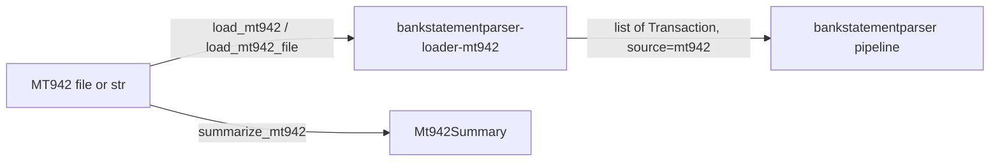

<!-- SPDX-License-Identifier: Apache-2.0 OR MIT -->

<p align="center">
  
</p>

<h1 align="center">bankstatementparser-loader-mt942</h1>

<p align="center">
  SWIFT MT942 Interim Transaction Report loader that parses MT942 wire format into bankstatementparser Transaction objects.
</p>

<p align="center">
  <a href="https://github.com/sebastienrousseau/bankstatementparser-loader-mt942/actions"></a>
  <a href="https://pypi.org/project/bankstatementparser-loader-mt942/"></a>
  <a href="https://sebastienrousseau.com/bankstatementparser-loader-mt942/"></a>
  <a href="https://scorecard.dev/viewer/?uri=github.com/sebastienrousseau/bankstatementparser-loader-mt942"></a>
  <a href="LICENSE"></a>
  <a href="https://github.com/sebastienrousseau/bankstatementparser-loader-mt942/blob/main/docs/POLICIES.md"></a>
</p>

<p align="center">
  
</p>

---

## Contents

**Getting started**

- [Install](#install): PyPI, source
- [Requirements](#requirements): toolchain floor, platforms
- [Quick Start](#quick-start): parse a report in a few lines

**The bankstatementparser-loader-mt942 ecosystem**

- [The bankstatementparser-loader-mt942 ecosystem](#the-bankstatementparser-loader-mt942-ecosystem): the core library, the other loaders and writers

**Library reference**

- [Capabilities at a glance](#capabilities-at-a-glance): the current surface by theme
- [Ecosystem comparison](#ecosystem-comparison): short matrix; full table at [`docs/COMPARISON.md`](docs/COMPARISON.md)
- [Benchmarks](#benchmarks): headline numbers; full table at [`docs/BENCHMARKS.md`](docs/BENCHMARKS.md)
- [Features](#features): tags, field mapping, summaries and errors
- [Configuration](#configuration): core options
- [Examples](#examples): runnable example index

**Operational**

- [When not to use bankstatementparser-loader-mt942](#when-not-to-use-bankstatementparser-loader-mt942): limitations
- [Development](#development): make targets, fuzzing, CI
- [Security](#security): guarantees and compliance
- [Documentation](#documentation): all reference docs
- [Stability guarantees](#stability-guarantees): SemVer axis, output stability, minimum toolchain discipline
- [License](#license)

---

## Install

### As a Python library

```bash
pip install bankstatementparser-loader-mt942
```

That installs the loader and pulls in [`bankstatementparser`](https://github.com/sebastienrousseau/bankstatementparser) (>= 0.0.36) automatically, which brings `pandas` and `pydantic`.

| Channel | Command | Notes |
| :--- | :--- | :--- |
| PyPI | `pip install bankstatementparser-loader-mt942` | Pulls in `bankstatementparser >= 0.0.36` |
| Source | `git clone https://github.com/sebastienrousseau/bankstatementparser-loader-mt942 && cd bankstatementparser-loader-mt942 && poetry install` | For development |

Verify the installation:

```sh
python -c "import bankstatementparser_loader_mt942 as m; print(m.__version__)"
# -> 0.0.37
```

---

## Requirements

- **Python 3.10 or later.** CI tests CPython 3.10, 3.11, 3.12, 3.13 and 3.14 on Linux, macOS and Windows; [`docs/POLICIES.md`](docs/POLICIES.md) says when the floor moves.
- **[`bankstatementparser`](https://pypi.org/project/bankstatementparser/) 0.0.36 or later**, whose `Transaction` model and `BankStatementParser` base class the loader produces and extends.
- No network access, native extensions or system packages of its own.

---

## Quick Start

```python
from bankstatementparser_loader_mt942 import load_mt942

mt942 = """:20:MT942REF001
:25:COBADEFFXXX/DE89370400440532013000
:28C:42/1
:34F:EURD0,00
:34F:EURC0,00
:13D:2506241200+0100
:61:2506240624C500,00NTRFINV-123//BANKREF1
:86:Incoming payment for invoice 123
:61:2506240624D200,50NTRFRENT//BANKREF2
:86:Monthly rent debit
:90D:1EUR200,50
:90C:1EUR500,00
-
"""

transactions = load_mt942(mt942)

for txn in transactions:
    print(txn.value_date, txn.currency, txn.amount, txn.description)
# 2025-06-24 EUR 500.00 Incoming payment for invoice 123
# 2025-06-24 EUR -200.50 Monthly rent debit
```

Those are `bankstatementparser.transaction_models.Transaction` objects with `source="mt942"`: debit lines carry a **negative** amount, credit lines a **positive** one, and amounts are exact `Decimal` values (SWIFT's comma decimal separator `500,00` becomes `Decimal("500.00")`).

To read from a file instead of a string:

```python
from bankstatementparser_loader_mt942 import (
    Mt942StatementParser,
    load_mt942_file,
)

# Use as a BankStatementParser instance
parser = Mt942StatementParser("statement.mt942")
df = parser.parse()

# Or load directly to Transaction models
transactions = load_mt942_file("statement.mt942")
```

---

## The bankstatementparser-loader-mt942 ecosystem

bankstatementparser-loader-mt942 is one of the input loaders of the `bankstatementparser` suite, whose packages ship one version together. The full table is in [The suite](docs/suite.md).

| Component | Purpose | Use case |
| :--- | :--- | :--- |
| [`bankstatementparser`](https://github.com/sebastienrousseau/bankstatementparser) | The parser core: CAMT, pain.001, CSV, OFX, QFX, MT940, MT942, BAI2 and PDF statements, and the `Transaction` model | Parsing statements from Python or the CLI |
| **`bankstatementparser-loader-mt942`** | This loader: MT942 text to `Transaction` objects and `:90D:` / `:90C:` roll-ups, with SWIFT envelopes and supplementary details handled | Loading intraday SWIFT reports |
| Other loaders | BAI2, CFONB 120, CAMT.054, SEPA pain.002 / pain.008 and BACS Standard 18 | Formats beyond the core |
| Writers and transport | XLSX, QIF, OFX and SWIFT writers; EBICS retrieval | Exporting transactions and fetching statements |
| [`bankstatementparser-mcp`](https://github.com/sebastienrousseau/bankstatementparser-mcp), [`bankstatementparser-lsp`](https://github.com/sebastienrousseau/bankstatementparser-lsp) | Agent tools and editor diagnostics over the core | AI agents and MT940 editing |



---

## Capabilities at a glance

| Area | Capability | Status |
| :--- | :--- | :--- |
| Loading | `load_mt942` (text) and `load_mt942_file` (path) to `list[Transaction]` | Shipped |
| Summary | `summarize_mt942` to an `Mt942Summary` with the `:90D:` / `:90C:` roll-ups and the `:13D:` stamp | Shipped |
| Core integration | `Mt942StatementParser`, a `BankStatementParser` registered as the `mt942` entry point in `bankstatementparser.loaders` | Shipped |
| Wire format | SWIFT envelopes, multi-line `:86:`, supplementary details, amounts without decimals, CRLF or LF | Shipped |
| Debit/credit marks | `C`, `D`, `RC`, `RD`, `EC`, `ED`, with an optional funds code | Shipped |
| Several messages per payload | One result per concatenated MT942 message | Considered ([roadmap](ROADMAP.md)) |

---

## Ecosystem comparison

The core `bankstatementparser` also ships an MT942 parser (`Mt942Parser`); this loader handles more of what real files carry. Every cell comes from the two projects' source code.

| Project | SWIFT envelope | `:90D:` / `:90C:` summaries | A malformed `:61:` line |
| :--- | :---: | :---: | :---: |
| **bankstatementparser-loader-mt942** | Unwrapped | Parsed | Skipped |
| `bankstatementparser` `Mt942Parser` | Not handled | Not read | Raises |

See [`docs/COMPARISON.md`](docs/COMPARISON.md) for the evidence and complete matrix.

---

## Benchmarks

`benches/bench_load_mt942.py` times `load_mt942` and `summarize_mt942` as a poll grows: transactions per report and reports per poll. Cost per transaction stays flat from 10 to 10,000 transactions, and a summary costs under a third of a full load.

| Scenario | Result | Environment |
| :--- | ---: | :--- |
| `load_mt942`, 1 report x 1,000 transactions (87 KiB) | 14.67 ms | Apple M1 Pro, macOS 27.2.1, CPython 3.12.16 |
| `load_mt942`, 50 reports x 200 transactions (861 KiB) | 148.67 ms | Apple M1 Pro, macOS 27.2.1, CPython 3.12.16 |
| `summarize_mt942`, 50 reports x 200 transactions (861 KiB) | 39.64 ms | Apple M1 Pro, macOS 27.2.1, CPython 3.12.16 |

See [`docs/BENCHMARKS.md`](docs/BENCHMARKS.md) for methodology and full results.

---

## Features

<!-- --8<-- [start:features] -->

### Supported tags

| Tag | Meaning | Cardinality |
| :--- | :--- | :--- |
| `:20:` | Transaction reference number | mandatory |
| `:25:` | Account identification (the account id) | mandatory |
| `:28C:` | Statement / sequence number | optional |
| `:34F:` | Floor limit indicator `<CCY>[D\|C]<amount>` (provides the currency) | one or two |
| `:13D:` | Date/time stamp `YYMMDDHHMM±HHMM` | optional |
| `:61:` | Statement line (one per booked entry) | repeatable |
| `:86:` | Information to account owner (attaches to the preceding `:61:`) | optional, per line |
| `:90D:` | Debit summary `<count><CCY><amount>` | optional |
| `:90C:` | Credit summary `<count><CCY><amount>` | optional |

Unrecognised tags (and the trailing `-` end-of-message marker) are
**silently ignored**, so future SWIFT additions do not break parsing.
A `:61:` line that does not match the statement-line grammar is
**skipped** rather than fatal, so one unrecognised row never aborts the
whole parse.

### Real-world wire-format constructs

Genuine bank/SWIFT exports are messier than the tidy sample above. The
loader handles the following, pinned by a golden test over a real,
third-party fixture in `tests/fixtures/real/` (its source, licensing
and provenance are in `tests/fixtures/real/PROVENANCE.md`):

- **SWIFT message envelope.** Messages wrapped in the header blocks
  `{1:...}{2:...}{3:...}` and the text block `{4:` ... `-}` are
  unwrapped before parsing; the envelope is never mistaken for content.
- **Amounts with no fractional digits.** A SWIFT amount may end on the
  decimal comma with nothing after it: `5000,` → `Decimal("5000")`,
  `0,` → `Decimal("0")`.
- **`:34F:` with an embedded D/C indicator.** `:34F:NZDC0,` yields
  currency `NZD` regardless of the `C`/`D` letter.
- **Multi-line `:86:`.** Continuation lines that do not start with a
  `:tag:` head (e.g. `/BAI/…`, `/BENM/…`, `/ACNO/…`) are appended to the
  `:86:` description, newlines preserved; CRLF and LF files give the
  same description.
- **Supplementary details after `:61:`.** A line immediately following a
  `:61:` (before any `:86:`), such as a bare `Transfer` or
  `wording/NBKT`, is the SWIFT supplementary-details subfield. It is
  **folded into the transaction's `description`** (supplementary text
  first, then the `:86:` content, joined by newlines) and never glued
  onto the statement-line tail, so the parsed `transaction_id` /
  `reference` stay clean. A `:61:` with supplementary details but no
  following `:86:` keeps that text as its description.

### Field mapping

Each `:61:` statement line becomes one `Transaction`:

| `Transaction` field | Source |
| :--- | :--- |
| `account_id` | `:25:` |
| `currency` | `:34F:` |
| `amount` | `:61:` amount as `Decimal`, negated for `D`, `RC` (reversal of credit) and `ED` (expected debit) lines; `C`, `RD` and `EC` stay positive |
| `value_date` | `:61:` value date (`YYMMDD`) |
| `booking_date` | `:61:` optional entry date (`MMDD`, inherits the value-date year) |
| `transaction_id` | the bank reference in the `:61:` tail (left of `//`) |
| `reference` | the customer reference in the `:61:` tail (right of `//`) |
| `description` | the following `:86:` free-form text |
| `source` | always `"mt942"` |
| `source_index` | the zero-based line index within the message |

The two-digit `YY` year uses the standard SWIFT sliding window: `00`-`79`
map to `20YY`, `80`-`99` to `19YY`. An optional one-letter funds code
after the debit/credit mark is accepted and not stored.

### Summaries

When you want the message metadata and the `:90D:`/`:90C:` roll-ups
rather than the individual transactions, call `summarize_mt942`:

```python
from bankstatementparser_loader_mt942 import summarize_mt942

summary = summarize_mt942(mt942)
print(summary.reference)          # MT942REF001
print(summary.currency)           # EUR
print(summary.debit_count)        # 1
print(summary.debit_sum)          # Decimal("200.50")
print(summary.credit_sum)         # Decimal("500.00")
print(summary.transaction_count)  # 2
```

`Mt942Summary` is a frozen dataclass with `reference`, `account_id`,
`currency`, `statement_datetime`, `debit_count`, `debit_sum`,
`credit_count`, `credit_sum`, and `transaction_count`. Optional fields
(no `:90x:` / `:13D:` present) default to `None`.

### Errors

A payload missing the mandatory `:20:` reference or `:25:` account
identification raises `ValueError` with a message naming the missing tag:

```python
load_mt942(":25:ACC\n:61:250624C10,00NTRFX\n")
# ValueError: MT942 payload missing required :20: reference
```

A malformed `:90D:` / `:90C:` summary, an impossible date, or an amount
that is not a SWIFT `15d` comma-decimal (digits with at most one comma,
at most 15 characters) also raises `ValueError`.

<!-- --8<-- [end:features] -->

---

## Configuration

The loader has no options, configuration file or environment variables: the tag set, the sign convention and the date window above are fixed, so the same report always loads the same way. Installing the package registers `Mt942StatementParser` under the `mt942` name in the `bankstatementparser.loaders` entry-point group, which is how the core discovers it; nothing needs to be configured for that.

---

## Examples

Two runnable examples live in [`examples/`](examples/), each run in CI:

| Example | Demonstrates |
| :--- | :--- |
| [`01_load_mt942.py`](examples/01_load_mt942.py) | Parse a small MT942 string into transactions |
| [`02_summarize_mt942.py`](examples/02_summarize_mt942.py) | Read a file and print the `Mt942Summary` roll-ups |

```sh
python examples/01_load_mt942.py
```

---

## When not to use bankstatementparser-loader-mt942

- **You have a PDF or CSV statement.** Use the core [`bankstatementparser`](https://github.com/sebastienrousseau/bankstatementparser) parsers directly; this loader is only for the SWIFT MT942 wire format.
- **You have MT940 (final statements with balances).** MT940 is a different message; this loader handles the interim MT942 report. The `:61:` / `:86:` grammar is shared, but MT942 has no `:60F:` / `:62F:` balances, and the loader never invents them.
- **You need bank-specific `:86:` sub-field parsing** (e.g. Deutsche Bank's `?20` / `?30` / `?32` GVC codes). The raw `:86:` value is preserved verbatim as the transaction `description`; downstream tooling can parse it if needed.
- **You need several messages from one payload kept apart.** Concatenated MT942 messages load as one stream; splitting them is on the [roadmap](ROADMAP.md).
- **Your MT942 is PGP / GPG encrypted.** Decrypt upstream and pass the plaintext to the loader.

---

## Development

```bash
git clone https://github.com/sebastienrousseau/bankstatementparser-loader-mt942.git
cd bankstatementparser-loader-mt942
poetry install
make check
```

`make check` runs the local gates: `ruff` and `black`, `mypy --strict`, the complexity baseline (`scripts/check_complexity.py`), `pytest` with a 100% line + branch coverage floor, `interrogate` at 100% docstring coverage, and the examples. Other targets: `make fuzz` (Atheris, 60 s, Linux x86_64 with Python 3.12+), `make docs` (the MkDocs manual, `--strict`), `make mutation` (mutmut, score in [`tests/MUTATION.md`](tests/MUTATION.md)) and `make demo` (re-renders the GIF above with VHS from `.github/demo.tape`). CI adds the OS by Python matrix, the fuzz run, CodeQL, `pip-audit` on the locked requirements and the Docs Lint gates. Documentation and example regression tests ([`tests/test_docs_accuracy.py`](tests/test_docs_accuracy.py), [`tests/test_regression_docs.py`](tests/test_regression_docs.py), [`tests/test_regression_examples.py`](tests/test_regression_examples.py)) execute every documented snippet and every `examples/*.py` script. [`CONTRIBUTING.md`](CONTRIBUTING.md) covers branches and commit signing.

---

## Security

- **Flat text, no XML.** MT942 has no XML envelope, so the XXE / billion-laughs surface does not apply; the loader reads text and files you pass it and writes nothing, with no network and no code execution.
- **Bounded parsing.** Field regexes are anchored and bounded, so catastrophic backtracking is not a concern, and a malformed amount is refused with `ValueError` rather than guessed at.
- **Fuzzing.** `fuzz/fuzz_load_mt942.py` drives `load_mt942` and `summarize_mt942` with Atheris in CI, seeded with the repository's fixtures, and fails on any exception other than `ValueError`, on a malformed `Transaction`, and on a summary that disagrees with the load.
- **Supply chain.** Dependencies are locked in `poetry.lock`, CI installs hash-pinned exports of it, and `pip-audit` and CodeQL run on every change. Releases publish to PyPI through OIDC trusted publishing and carry cosign signatures, SLSA provenance and SBOMs; every workflow action is pinned by commit SHA except the SLSA generator, which must be referenced by tag.

Report vulnerabilities according to [`SECURITY.md`](SECURITY.md).

---

## Documentation

- **User manual:** [sebastienrousseau.com/bankstatementparser-loader-mt942](https://sebastienrousseau.com/bankstatementparser-loader-mt942/), built from [`docs/`](docs/) with MkDocs
- **API reference:** [the manual's API page](https://sebastienrousseau.com/bankstatementparser-loader-mt942/api/), generated from the docstrings
- **Developer docs:** [`CONTRIBUTING.md`](CONTRIBUTING.md), [`ARCHITECTURE.md`](ARCHITECTURE.md), [`RELEASING.md`](RELEASING.md)
- **The suite:** [`docs/suite.md`](docs/suite.md), with every `bankstatementparser` package
- **History:** [`ROADMAP.md`](ROADMAP.md), [`CHANGELOG.md`](CHANGELOG.md)
- **Specification:** the SWIFT User Handbook MT942 _Interim Transaction Report_; the loader follows the common subset shipped by major EU and UK commercial banks

---

## Stability guarantees

- **Versioning.** Releases stay on the `0.0.x` line and step by exactly `0.0.1`, in lockstep with the rest of the `bankstatementparser` suite. Under SemVer a `0.0.x` release may break anything; this project names each break in the CHANGELOG instead.
- **The breaking axis is the output**: which `:61:` lines produce a `Transaction`, the sign of each amount, how each `Transaction` field is filled, and the `Mt942Summary` fields. Changing any of them for a report that loaded before is a breaking change and is called out in the CHANGELOG, even when no Python signature moves.
- **Output stability.** The loader is deterministic: the same payload gives the same transactions in the same order.
- **Python API.** `load_mt942`, `load_mt942_file`, `summarize_mt942`, `Mt942Summary` and `Mt942StatementParser` keep their names and fields; names starting with `_` are internal.
- **Minimum toolchain.** Python 3.10 is the floor; it moves only in a release, for the whole suite at once, with the reason in the CHANGELOG ([`docs/POLICIES.md`](docs/POLICIES.md)).

---

## License

Dual-licensed under [Apache License, Version 2.0](LICENSE-APACHE) or [MIT](LICENSE-MIT), at your option (`SPDX-License-Identifier: Apache-2.0 OR MIT`). Built on the core [`bankstatementparser`](https://github.com/sebastienrousseau/bankstatementparser) library. Any contribution submitted for inclusion in the work shall be dual-licensed as above, without additional terms or conditions.
